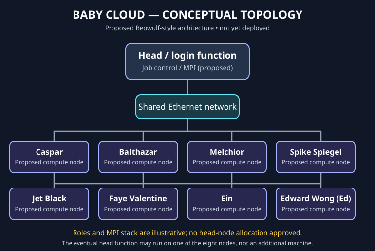

# Baby Cloud

**An expandable Raspberry Pi Beowulf-style parallel-computing cluster and Linux infrastructure engineering laboratory.**

**Author:** David M. Talarico  
**Current documented status:** November 9, 2026  
**Deployed:** Two Raspberry Pi 4 (4 GB) nodes, remotely accessible by SSH  
**Long-term goal:** Eight cooperating physical compute nodes

> **Engineering principle:** The future must know what the past was thinking—and what the past actually proved.

## Current verified status

| Component or capability | Last documented evidence | Status |
|---|---|---|
| Node 1: `CASPER-01` | Raspberry Pi OS; successful SSH from Windows by hostname and previously by IPv4 | **Verified Nov 8** |
| Node 2: `BALTHAZAR-02` | Raspberry Pi OS; headless first boot and independent successful SSH login using final hostname | **Verified Nov 8** |
| Network | Both nodes connected via a TP-Link TL-SG116E 16-port Gigabit switch to the existing AT&T gateway | **Documented** |
| Troubleshooting | Diagnosed stale Avahi/mDNS advertising after Node 2 rename; successful reconnect by new name | **Verified Nov 8** |
| True multi-node MPI computation | No coordinated parallel job yet completed or verified | **Not implemented** |
| Additional nodes, Rocky Linux, Gentoo, Linux From Scratch, NAS, DX League | Future proposals and experiments | **Not deployed** |

The above results come from the linked engineering records. No live-device verification was performed during the November 9 documentation changes. The original purchasing plans remain available in the historical archive; their older status statements do **not** describe today's deployment.

## What's been demonstrated

- Commissioned two physical Raspberry Pis running Raspberry Pi OS.
- Prepared Node 2 for first boot without a directly attached display or keyboard and authenticated remotely by SSH.
- Accessed both nodes from Windows by their actual configured hostnames.
- Investigated a hostname-resolution failure by distinguishing Linux hostname configuration, local host entries, Avahi/mDNS announcements, and SSH connectivity.
- Recorded commands, observed output, corrections, and author-led versus assisted work in dated records.

**Not yet demonstrated:** a distributed MPI computation, performance scaling, automated rebuild, proven backup restoration, or production-style monitoring and recovery.

## Architecture and topology

[View the conceptual eight-node topology (SVG)](diagrams/baby-cloud-conceptual-eight-node-topology.svg).

**PROPOSED topology, not an as-built diagram.** Today, only `CASPER-01` and `BALTHAZAR-02` are documented as commissioned. A future NAS is planned as separate storage, not a replacement for a compute node. See [architecture and design trade-offs](docs/architecture.md) and the [diagram index](diagrams/README.MD).

## Next engineering milestone: MPI

The founding objective is for multiple physical nodes to cooperate on **one computational workload** and combine results—not merely to share a network.

**Next steps:** Confirm live inter-node communication, select a Message Passing Interface (MPI) implementation, choose consistent host and authentication conventions, then execute a minimal genuine two-node parallel job.

**Pass criteria:** Evidence from both participating nodes, a verified combined result, a single-node baseline, two-node timings, an account of communication overhead, and reproducible commands/source. **MPI is not yet implemented or verified.**

The complete milestone and future infrastructure-skill targets are in [Portfolio Readiness and Acceptance Criteria](docs/portfolio-readiness.md).

## Engineering portfolio

Baby Cloud develops demonstrable Linux, networking, distributed-computing and infrastructure operations skills. The portfolio roadmap distinguishes **already verified** work from **additional evidence needed** for a strong hiring discussion, including repeatable automation, enterprise Linux administration, tested backup/restore, monitoring, troubleshooting, benchmarking and a concise demonstration.

These are evidence goals, **not promises of hiring** or prerequisites for completing all eight nodes before applying for jobs.

## Documentation: where to go next

| Reader needs | Authoritative document |
|---|---|
| Current state, blockers and exact resumption task | [PROJECT_CONTINUITY.md](PROJECT_CONTINUITY.md) |
| Why the system is designed this way | [Architecture](docs/architecture.md) and [decision records](docs/decisions/) |
| How the latest physical-node work was carried out and verified | [November 8 headless commissioning and troubleshooting journal](docs/journal/2026-11-08-balthasar-2-headless-preparation.md) |
| Older commissioning and hardware history | [Engineering journal](docs/journal/) and [project logs](journal/) |
| Network and hardware purchasing records | [Network topology notes](docs/network-topology.md) and [procurement](docs/procurement/) |
| Diagrams and their proposed/verified labels | [Diagram index](diagrams/README.MD) |
| Standards for documentation and evidence | [Documentation policy](docs/documentation-policy.md) |
| Measurable portfolio gaps and acceptance criteria | [Portfolio roadmap](docs/portfolio-readiness.md) |
| Entire previous README, preserved verbatim | [README historical archive](README-HISTORY.md) |

**Documentation rule:** This README is a short, current landing page, **not** an accumulating chronological journal. New milestones should update its current-status and evidence links while preserving the original facts, dated decisions, mistakes, and reasoning in the appropriate engineering records. Version-control any useful diagrams and distinguish proposals from actual verified deployments.

## Future direction

Complete the first two-node MPI demonstration; expand through the MAGI node group and subsequent nodes as resources permit; evaluate Rocky Linux, Gentoo and Linux From Scratch in a deliberately tested sequence; and eventually develop appropriate Radio Free Redoubt / DX League applications, shared NAS storage and advanced administration experiments. These future ideas are **proposed** and are not implemented capabilities.

## Historical preservation

The [complete earlier README](README-HISTORY.md) is maintained intact as a historical snapshot. The dated journals, procurement records, decisions, and Git history remain in their original locations. Historical material should be easy to find without obstructing a reader seeking the newest verified status.
